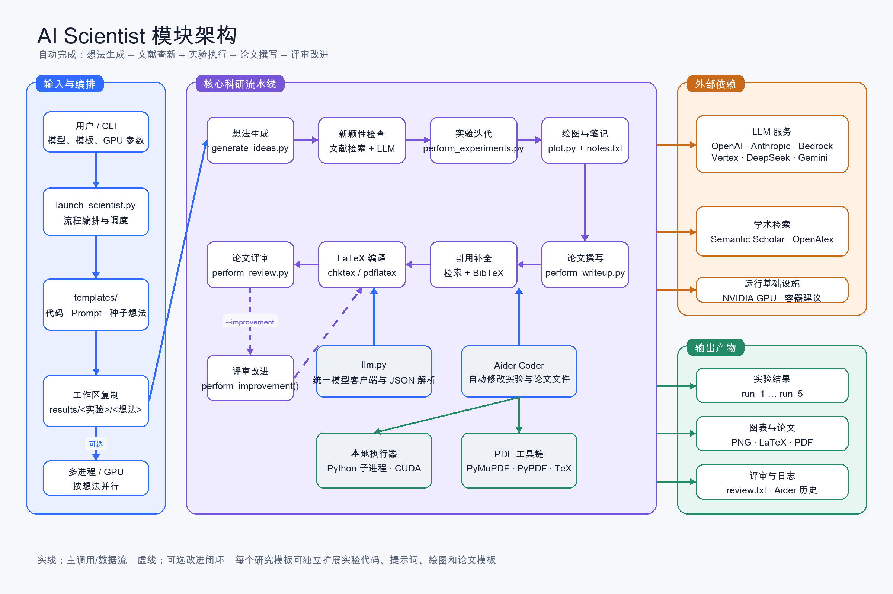
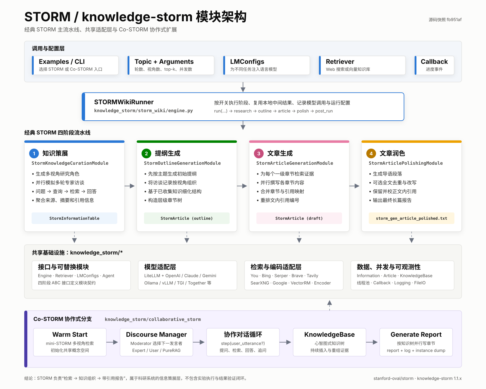

# AutoResearchClaw 同类开源项目调研

> 调研时间：2026-07-21  
> 筛选标准：GitHub Star 高于 [AutoResearchClaw](https://github.com/aiming-lab/AutoResearchClaw) 的 13,849；功能涉及自主科研、自动实验或深度研究。  
> 注意：Star 会持续变化，本文数据是调研时的快照。

## 结论摘要

严格意义上，**AI-Scientist** 与 AutoResearchClaw 最相似，都覆盖从研究想法、实验执行到论文生成的完整流程。**RD-Agent** 和 **karpathy/autoresearch** 更侧重实验及研发闭环；**STORM、GPT Researcher、Tongyi DeepResearch** 等主要解决资料检索和研究报告生成，并不等同于完整的自主科研系统。

推荐按目标选择：

1. 完整“想法 → 实验 → 论文”流程：**AI-Scientist**
2. 自动实验和循环优化：**karpathy/autoresearch、RD-Agent**
3. 文献搜索与带引用报告：**STORM、GPT Researcher、Tongyi DeepResearch**
4. 可自托管的通用研究助理：**Khoj**

## 核心项目架构一览

### AutoResearchClaw

覆盖主题输入、研究规划、文献调研、实验执行、论文生成与评审反馈的完整自主科研流程。

### AI-Scientist

以想法生成、实验迭代、论文写作和自动评审构成端到端科研闭环。

### STORM

以多视角提问驱动资料检索和知识策展，再依次完成提纲、带引用正文与文章润色；详见[项目总结](storm.md)。

### GPT Researcher

通过研究规划、并行检索与抓取、上下文压缩和报告生成构建自动化深度研究流程。

## 项目对比

| 项目 | Stars | 相比 AutoResearchClaw | 主要定位 | 与 AutoResearchClaw 的关系 |
|---|---:|---:|---|---|
| [karpathy/autoresearch](https://github.com/karpathy/autoresearch) | 91,687 | +77,838 | AI Agent 自动运行单 GPU 模型训练实验 | 实验自迭代能力强，但不覆盖完整论文流程 |
| [khoj-ai/khoj](https://github.com/khoj-ai/khoj) | 35,908 | +22,059 | 可自托管个人 AI、Deep Research、自定义 Agent 与自动化 | 更偏通用研究助理，科研工作流不是唯一重点 |
| [stanford-oval/storm](https://github.com/stanford-oval/storm) | 30,178 | +16,329 | 自动资料研究、知识整理和带引用长报告生成 | 覆盖检索与写作，不负责科研实验闭环 |
| [assafelovic/gpt-researcher](https://github.com/assafelovic/gpt-researcher) | 28,514 | +14,665 | 使用多种 LLM 和数据源执行自主深度研究 | 研究报告能力成熟，但不是完整 AI Scientist 系统 |
| [Alibaba-NLP/DeepResearch](https://github.com/Alibaba-NLP/DeepResearch) | 19,697 | +5,848 | 通义开源 Deep Research Agent | 侧重多步搜索、推理和报告生成 |
| [dzhng/deep-research](https://github.com/dzhng/deep-research) | 19,386 | +5,537 | 轻量级迭代式深度研究 Agent | 适合参考研究方向细化与循环检索实现 |
| [SakanaAI/AI-Scientist](https://github.com/SakanaAI/AI-Scientist) | 14,261 | +412 | 自动提出想法、运行实验、绘图、写论文及模拟评审 | **同类项目中流程最接近 AutoResearchClaw** |
| [microsoft/RD-Agent](https://github.com/microsoft/RD-Agent) | 13,969 | +120 | 自动化数据与模型研发流程 | 具备想法、实现、实验反馈和循环优化，论文写作并非唯一目标 |

## 分类型分析

### 1. 完整自主科研

#### AI-Scientist

[SakanaAI/AI-Scientist](https://github.com/SakanaAI/AI-Scientist) 是最值得与 AutoResearchClaw 直接比较的项目。它覆盖研究想法生成、代码修改、实验运行、结果可视化、论文撰写和模拟审稿。其优势是科研闭环完整、学术影响力较强；局限是实验范围受模板和既有代码库约束。

### 2. 自动实验与研发闭环

#### karpathy/autoresearch

[karpathy/autoresearch](https://github.com/karpathy/autoresearch) 让 Agent 在单 GPU 环境中持续修改训练代码、运行实验、比较指标并保留有效改动。它没有把论文生成作为核心，但实验循环简单清晰，Star 显著高于其他项目，适合参考自主实验控制和结果驱动迭代机制。

#### RD-Agent

[microsoft/RD-Agent](https://github.com/microsoft/RD-Agent) 面向数据和模型研发自动化，支持研究想法生成、代码实现、实验反馈及反复优化。它比通用 Deep Research Agent 更接近真实研发流程，适合数据科学、量化研究和模型优化场景。

### 3. 深度检索与研究报告

- [STORM](https://github.com/stanford-oval/storm)：强调多视角信息组织、引用和长篇文章生成，适合文献调研模块；详见[项目总结与模块架构](storm.md)。
- [GPT Researcher](https://github.com/assafelovic/gpt-researcher)：支持多模型和多数据源，工程成熟度较高，适合集成自动研究报告能力。
- [Tongyi DeepResearch](https://github.com/Alibaba-NLP/DeepResearch)：强调多步推理和自主搜索，可作为 Deep Research Agent 基线。
- [dzhng/deep-research](https://github.com/dzhng/deep-research)：实现相对轻量，适合理解迭代搜索和研究方向细化的基本结构。

### 4. 通用研究助理

[khoj-ai/khoj](https://github.com/khoj-ai/khoj) 支持本地或在线模型、个人资料检索、Web 搜索、自定义 Agent、定时任务和 Deep Research。它的范围比 AutoResearchClaw 更广，但不专注于科学实验和论文产出。

## 推荐研究顺序

1. **AI-Scientist**：比较完整科研管线及论文生成机制。
2. **karpathy/autoresearch**：研究最简洁的自主实验循环。
3. **RD-Agent**：研究模块化 R&D 自动化和反馈优化。
4. **STORM / GPT Researcher**：补充检索、引用与报告写作能力。
5. **Tongyi DeepResearch / dzhng/deep-research**：比较不同 Deep Research Agent 的搜索与推理设计。

## 判断限制

- Star 代表社区关注度，不直接代表科研质量、复现能力或生产可用性。
- “类似”按功能重叠程度判断；除 AI-Scientist 外，多数项目只覆盖 AutoResearchClaw 的一部分。
- 本表未纳入 Star 低于或等于 AutoResearchClaw 的项目，即使部分项目在特定科研领域更相似。
- 各项目的活跃度、许可证、运行成本和模型依赖仍需在实际选型前单独核查。

## 参考来源

- [AutoResearchClaw](https://github.com/aiming-lab/AutoResearchClaw)
- [AI-Scientist](https://github.com/SakanaAI/AI-Scientist)
- [RD-Agent](https://github.com/microsoft/RD-Agent)
- [GPT Researcher](https://github.com/assafelovic/gpt-researcher)
- [STORM](https://github.com/stanford-oval/storm)
- [Tongyi DeepResearch](https://github.com/Alibaba-NLP/DeepResearch)
- [Awesome AutoResearch](https://github.com/alvinreal/awesome-autoresearch)
- [AutoResearch Tools Compared](https://rywalker.com/research/autoresearch-tools)
