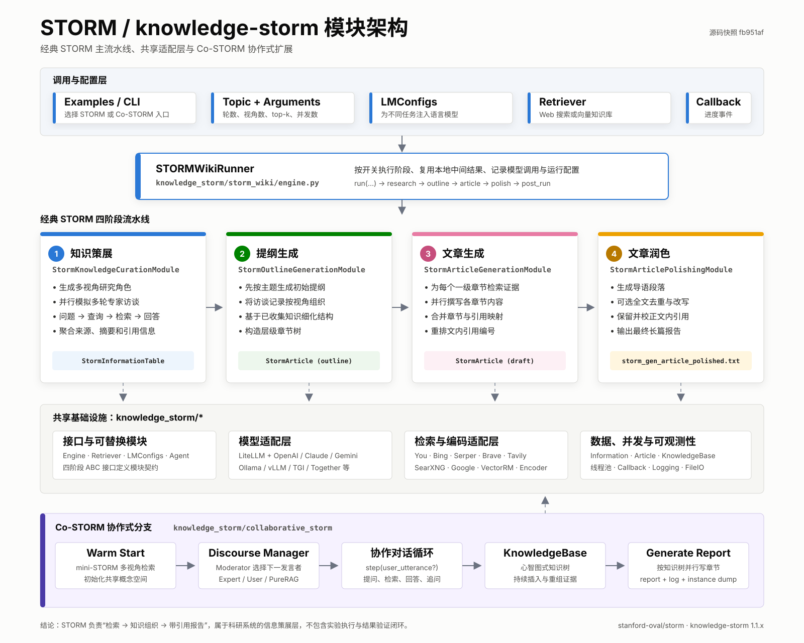

# STORM 项目总结

> 源码位置：`/Users/jinzili/code/AutoResearch/storm`  
> 分析快照：`fb951af`（2025-09-30）  
> 上游仓库：[stanford-oval/storm](https://github.com/stanford-oval/storm)

## 项目定位

STORM（**Synthesis of Topic Outlines through Retrieval and Multi-perspective Question Asking**）是一个面向知识策展和长篇报告生成的框架。它先让多个带不同视角的“写作者”与主题专家进行模拟访谈，再把检索到的证据组织成层级提纲，逐节写成带引用的文章。

它的边界很明确：STORM 和 Co-STORM 工作在**信息策展层**，解决资料搜索、观点覆盖、知识组织、引用和报告写作；它们不负责提出可检验假设、修改实验代码、执行实验或依据结果迭代研究方向。因此，在自主科研系统中，STORM 更适合作为“文献调研 / Research Brief / Related Work”模块，而不是完整的科研闭环。

## 模块架构

架构由四层组成：

| 层次 | 核心模块 | 责任 |
|---|---|---|
| 调用与配置 | `examples/`、`STORMWikiRunnerArguments`、`STORMWikiLMConfigs` | 选择运行模式，配置主题、并发、检索深度和不同任务使用的模型 |
| 经典流水线 | `knowledge_storm/storm_wiki/` | 按“知识策展 → 提纲 → 正文 → 润色”生成带引用长文 |
| 协作式流水线 | `knowledge_storm/collaborative_storm/` | 通过主持人、专家和用户的多轮对话持续扩展心智图式知识库 |
| 共享基础设施 | `interface.py`、`lm.py`、`rm.py`、`encoder.py`、`dataclass.py` | 定义扩展接口，适配模型和检索后端，提供数据结构、编码、日志与持久化能力 |

## 经典 STORM 运行链路

入口是 [`STORMWikiRunner`](https://github.com/stanford-oval/storm/blob/fb951af/knowledge_storm/storm_wiki/engine.py)。`run()` 可以独立启停各阶段，也可以从磁盘加载上次运行的中间结果，便于重跑后半段流水线。

### 1. 知识策展

[`StormKnowledgeCurationModule`](https://github.com/stanford-oval/storm/blob/fb951af/knowledge_storm/storm_wiki/modules/knowledge_curation.py) 完成最关键的信息收集工作：

1. `StormPersonaGenerator` 根据主题生成若干研究视角，例如历史、工程、伦理或产业视角。
2. 每个视角由 `WikiWriter` 与 `TopicExpert` 进行多轮模拟访谈，不同视角可以在线程池中并行执行。
3. 专家把自然语言问题转换为多个搜索查询，经 `Retriever` 获取网页或向量库结果，再基于证据生成回答。
4. 对话、URL、摘要和引用信息被汇总到 `StormInformationTable`，并建立可供后续章节检索的语义索引。

这一设计的核心价值不是“多 Agent”本身，而是用**多视角提问扩大资料覆盖面**，降低只按单一搜索计划收集资料造成的遗漏。

### 2. 提纲生成

[`StormOutlineGenerationModule`](https://github.com/stanford-oval/storm/blob/fb951af/knowledge_storm/storm_wiki/modules/outline_generation.py) 先根据主题生成草稿提纲，再把各视角的访谈记录纳入上下文，生成更完整的层级章节树。提纲由 `StormArticle` 表示，因此后续可以直接在树上插入或更新章节。

### 3. 文章生成

[`StormArticleGenerationModule`](https://github.com/stanford-oval/storm/blob/fb951af/knowledge_storm/storm_wiki/modules/article_generation.py) 针对每个一级章节重新从 `StormInformationTable` 检索最相关的证据，并行撰写章节，然后合并文章树和引用映射。引用编号会在合并后统一重排，避免不同并发任务之间发生编号冲突。

### 4. 文章润色

[`StormArticlePolishingModule`](https://github.com/stanford-oval/storm/blob/fb951af/knowledge_storm/storm_wiki/modules/article_polish.py) 为文章补充导语，并可选择额外调用模型进行全文去重和改写。最终结果仍保留结构化章节和引用信息，而不是只返回一段不可追踪的纯文本。

## Co-STORM 分支

Co-STORM 把一次性报告流水线改造成可与用户共同探索主题的对话系统，入口是 [`CoStormRunner`](https://github.com/stanford-oval/storm/blob/fb951af/knowledge_storm/collaborative_storm/engine.py)：

1. `WarmStartModule` 运行一个缩小版 STORM，通过多视角检索初始化共享概念空间。
2. `DiscourseManager` 在 `Moderator`、多个 `CoStormExpert`、`PureRAGAgent` 和模拟用户之间选择下一位发言者。
3. 每次 `step()` 都可能产生新问题、检索结果和带依据的回答，并把信息插入 `KnowledgeBase`。
4. `KnowledgeBase` 使用可持续扩展和重组的知识树，而不是经典 STORM 的静态访谈表。
5. `generate_report()` 按知识树并行撰写章节，输出当前对话阶段的综合报告。

经典 STORM 适合“给定主题，一次生成完整报告”；Co-STORM 适合“用户边读边追问，系统持续整理知识”。

## 扩展接口与依赖

[`interface.py`](https://github.com/stanford-oval/storm/blob/fb951af/knowledge_storm/interface.py) 定义了 `Engine`、`Retriever`、`LMConfigs`、`Agent` 以及四个经典阶段的抽象接口。自定义系统可以替换任一阶段，而不必重写整个 Runner。

- 模型层：主要通过 LiteLLM 接入模型，同时保留 OpenAI、Claude、Gemini、Ollama、vLLM、TGI、Together 等适配类。
- 检索层：内置 You、Bing、Serper、Brave、SearXNG、DuckDuckGo、Tavily、Google、Azure AI Search、VectorRM 等实现。
- 编码层：`Encoder` 为信息表和 Co-STORM 知识库提供语义向量，用于证据检索、去重或节点匹配。
- 编排层：基于 DSPy 模块和 Signature 表达各类模型任务，使用线程池并行访谈、检索和章节生成。
- 可观测性：Callback 暴露阶段事件，Runner 保存运行参数、模型调用历史和信息来源映射。

## 运行产物

经典 STORM 会在主题目录中保存：

| 文件 | 内容 |
|---|---|
| `conversation_log.json` | 多视角模拟访谈及其搜索过程 |
| `raw_search_results.json` | URL 到标题、摘要和片段的映射 |
| `storm_gen_outline.txt` | 生成的层级提纲 |
| `storm_gen_article.txt` | 带引用的文章草稿 |
| `storm_gen_article_polished.txt` | 润色后的最终文章 |
| `url_to_info.json` | 文章实际采用的来源信息 |
| `run_config.json` | Runner 参数和模型配置 |
| `llm_call_history.jsonl` | 模型调用历史 |

Co-STORM 示例额外保存 `report.txt`、`log.json` 和 `instance_dump.json`，后者包含对话、专家列表与知识库状态，可用于恢复或分析一次协作过程。

## 工程评价

### 值得复用的设计

- **阶段边界清晰**：中间结果都可持久化，检索、写作和润色能够分别调试或重跑。
- **证据先于写作**：文章生成只从已收集的信息表中检索材料，来源和文本之间存在明确映射。
- **任务级模型配置**：提问、回答、提纲和正文可以使用不同成本或能力的模型。
- **并发粒度合理**：不同视角访谈、搜索查询和章节写作天然独立，适合线程池并发。
- **经典与交互模式共存**：STORM 提供稳定批处理，Co-STORM 提供持续探索，两者共享适配层和数据能力。

### 主要限制

- 生成质量依赖搜索引擎覆盖、网页抽取质量和模型对来源的忠实度；“带引用”不等于引用内容一定支持对应论断。
- 多视角访谈会显著放大模型调用和检索次数，`max_perspective × max_conv_turn × queries_per_turn` 是主要成本来源。
- 并发主要使用线程池，受外部 API 限流和失败重试影响，生产环境仍需额外的任务队列、缓存和速率治理。
- `knowledge_storm` 1.1.x 同时保留 LiteLLM 与多套历史模型封装，适配面广，但模型层存在一定兼容维护成本。
- 当前源码快照未发现独立的 `tests/` 测试套件，仓库主要依靠示例脚本作为集成入口；二次开发时应补充阶段契约和引用一致性测试。
- 它不包含实验执行、指标判断、结果复现和研究分支回退，不能单独替代完整 AutoResearch 系统。

## 对自主科研系统的启示

将 STORM 接入研究演化树时，最合适的节点是“研究主题 → 文献认知”：把 `StormInformationTable` 或 Co-STORM `KnowledgeBase` 作为可版本化研究资产，把提纲和报告作为派生产物。后续的 Research Plan、实验分支和评审节点应由实验执行与评估系统负责，而不是继续堆叠在 STORM 的文章生成 Runner 中。

建议优先复用三个能力：多视角问题生成、带来源的信息表、按提纲检索证据并并行写作。模型供应商适配和具体搜索后端则可以按目标系统现有基础设施替换。
